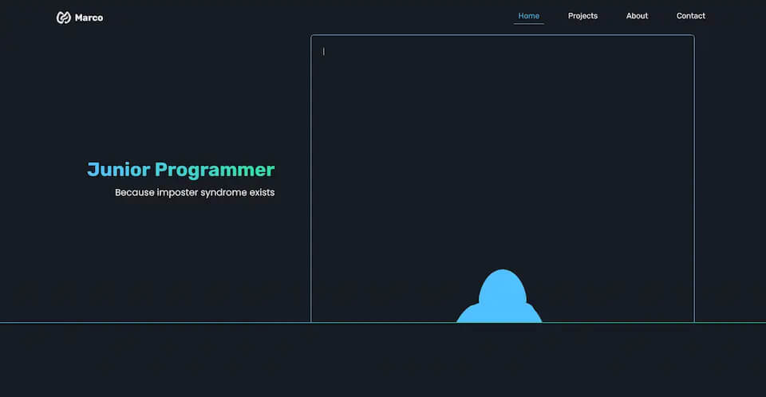

# Portfolio Pages

My personal portfolio website, where I show my projects and write about how I built them.
It's built with **HTML, CSS and Jekyll** and hosted on GitHub Pages, with **no JavaScript**.

🔗 **Live site:** https://pnguinmster.github.io/portfolio-pages
🎨 **Design:** [Figma file](https://www.figma.com/design/kLWD9lSlAYHygVZhUK42a3/Portfolio-Pages-Design)



## About

I built this site from scratch to learn web development and to practice managing a project on GitHub, using Issues, a Projects board and a `dev` → `main` workflow.
I designed everything in Figma before writing any code: a user-flow chart, a style guide, page mockups, a hand-made logo and animated code-snippet heroes.

📖 The full story is in the blog post on the site: [Portfolio Website](https://pnguinmster.github.io/portfolio-pages/blog_pages/portfolio-website-blog).

## Highlights

- **Interaction without JavaScript.** Hero animations play on click through a hidden checkbox toggle.
- **Gradient borders with transparent backgrounds,** made with `::before` / `::after`. I also use gradient text and dividers.
- **Jekyll templating.** Shared layouts and includes, and blog posts written in Markdown. Front matter drives the table of contents, tags and featured projects.
- **Responsive and optimized.** WebP images with JPG fallback, self-hosted fonts, and modular CSS with variables.

## Tech Stack

| Area      | Tools                              |
|-----------|------------------------------------|
| Frontend  | HTML5, CSS3                        |
| Site      | Jekyll, Liquid, Markdown (kramdown) |
| Hosting   | GitHub Pages                       |
| Dev       | Docker, Docker Compose             |
| Design    | Figma, Inkscape, Krita             |

## Run Locally

```bash
docker compose up --build
```

Then open http://localhost:4000/portfolio-pages/. The page reloads automatically when you save changes.

## Author

**Marco G.** · [GitHub](https://github.com/PnguinMster)
